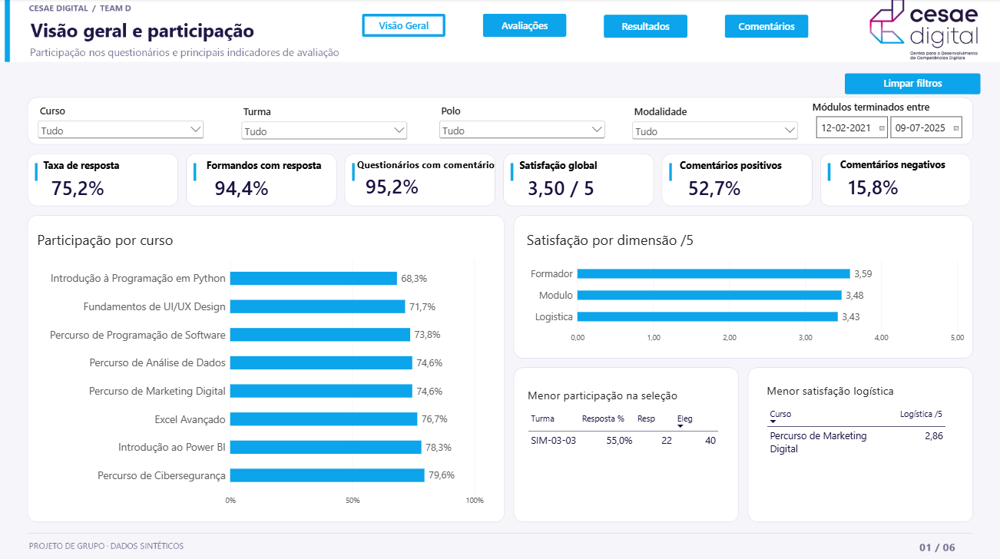
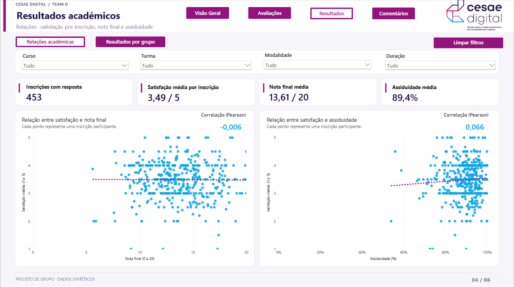
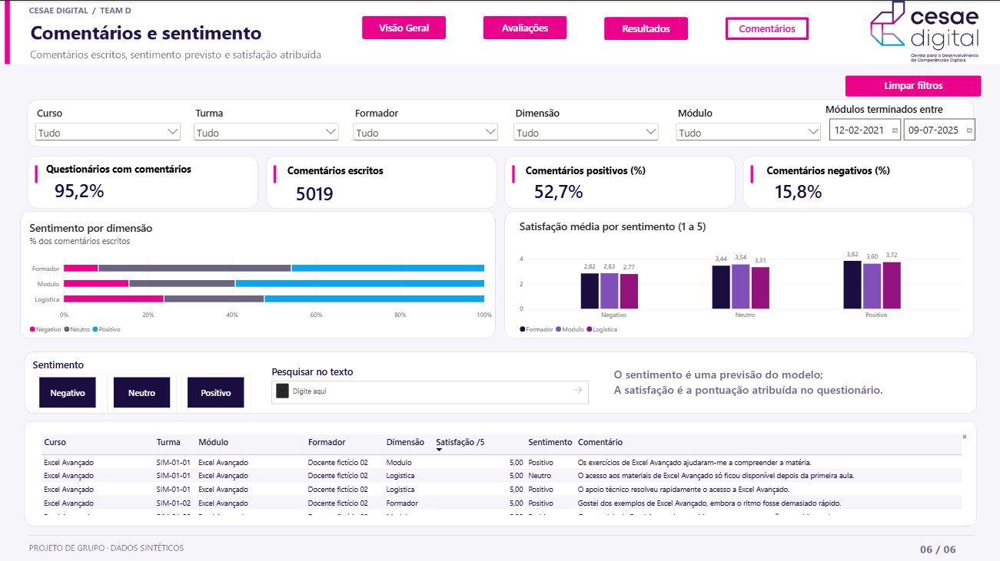

# Análise da satisfação dos formandos

Projeto final da formação de Data Analyst no CESAE Digital, desenvolvido por Diogo Gomes, Kelly Pitella e Lucas Rocha.

Construímos um dashboard em Power BI para explorar a satisfação dos formandos com os formadores, módulos e logística. A análise cruza as avaliações com notas, assiduidade e comentários escritos.

> Os dados são sintéticos. O dashboard apresenta uma abordagem de análise e não descreve a realidade do CESAE Digital.



## Perguntas de negócio

- Como varia a participação nos questionários entre cursos e turmas?
- Como são avaliados os formadores, os módulos e a logística?
- Onde se concentram as avaliações mais baixas?
- Existe uma associação entre satisfação, nota final e assiduidade?
- O que acrescentam os comentários à leitura das pontuações?

Transformar estas perguntas num dashboard claro foi uma parte importante do projeto. Definimos as medidas, organizámos a informação e construímos páginas para permitir explorar cada tema.

## Dashboard

O relatório tem seis páginas: visão geral e participação, síntese de avaliações, detalhe das avaliações, relações académicas, resultados por grupo e comentários com sentimento previsto.



As correlações permitem explorar associações entre satisfação, nota final e assiduidade. Não demonstram uma relação de causa e efeito.



Na página de comentários, o sentimento previsto complementa a análise. A satisfação é a pontuação atribuída no questionário; o sentimento é uma classificação do texto do comentário.

## Dados e ferramentas

| Elemento | Quantidade |
| --- | ---: |
| Questionários elegíveis | 3 420 |
| Questionários respondidos | 2 572 |
| Inscrições | 480 |
| Cursos | 8 |
| Turmas | 24 |
| Comentários escritos | 5 019 |

Usámos Excel na consulta e verificação dos dados, Python na preparação dos comentários e classificação do sentimento, Power BI na modelação e visualização, e DAX no cálculo de indicadores de participação, satisfação e correlação.

## Como consultar

1. Abrir [CESAE_Analise_Sentimento.pbix](dashboard/CESAE_Analise_Sentimento.pbix) no Power BI Desktop.
2. Se for necessário atualizar os dados, ajustar no Power Query os caminhos para os ficheiros em `dados/`.
3. Explorar as páginas e os filtros do relatório.

## Estrutura do repositório

```text
.
├── codigo/       # ficheiros de apoio à análise
├── dados/        # dados sintéticos usados pelo dashboard
├── dashboard/    # ficheiro Power BI
└── docs/imagens/ # capturas do dashboard usadas neste README
```

## Equipa

O projeto foi desenvolvido com trabalho e decisões partilhados por:

- [Diogo Gomes](https://github.com/dgomes-gh)
- [Kelly Pitella](https://github.com/KellyPitella)
- [Lucas Rocha](https://github.com/lucashdrocha)

## Agradecimentos

Agradecemos ao CESAE Digital pela formação de Data Analyst e aos formadores pelo acompanhamento ao longo do curso.
